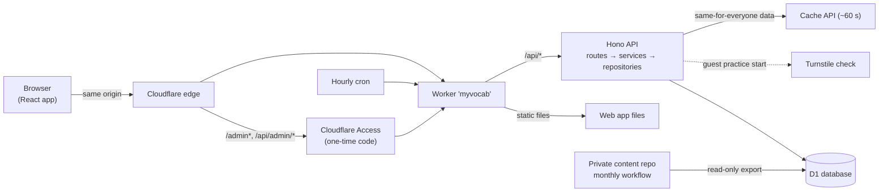
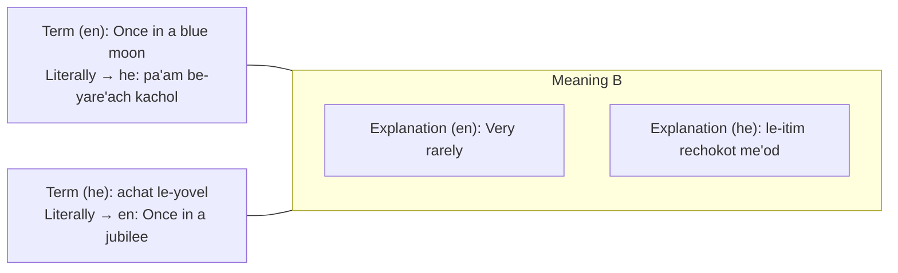
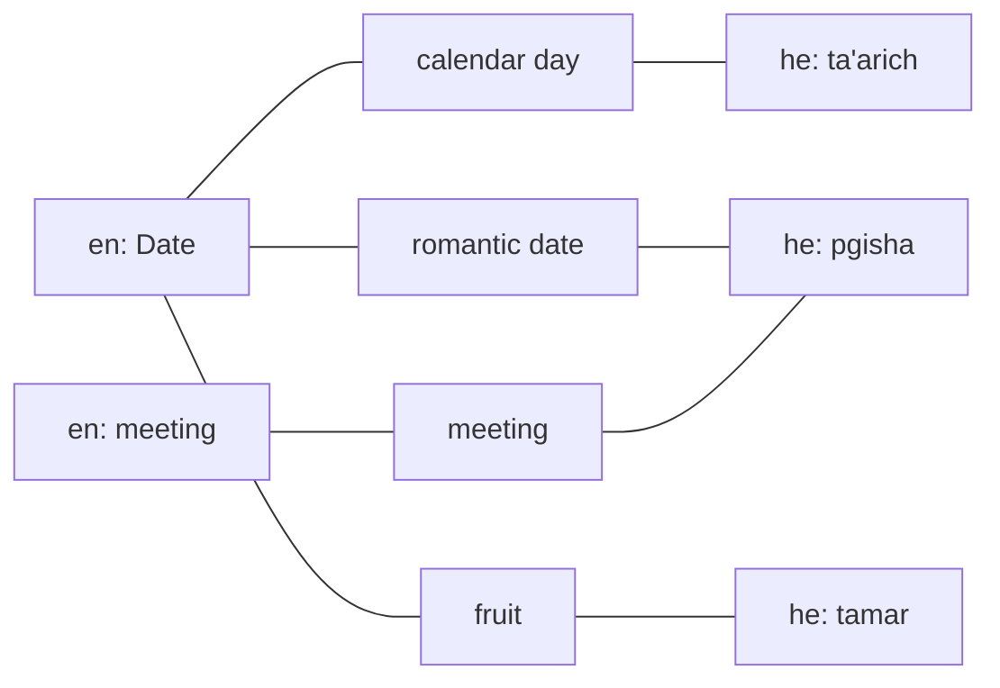
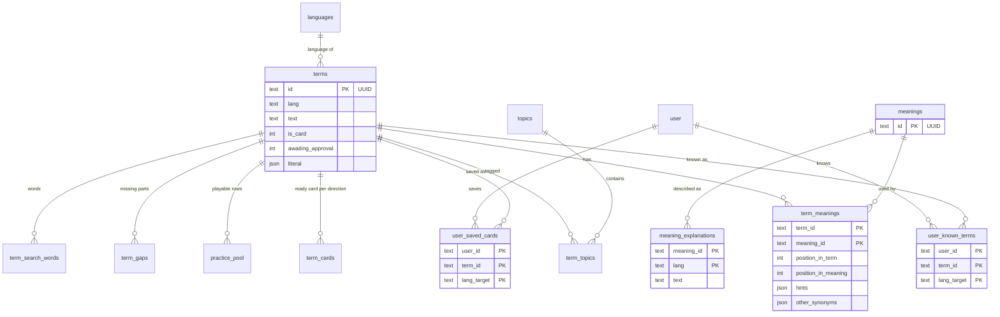
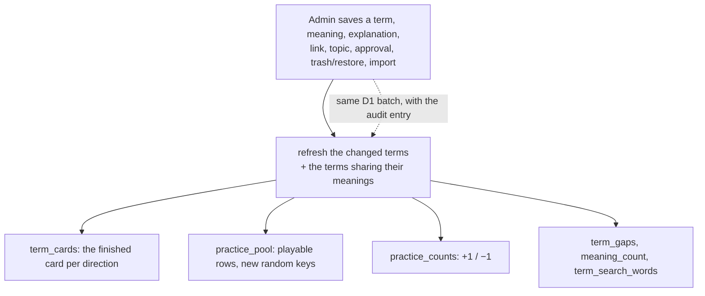
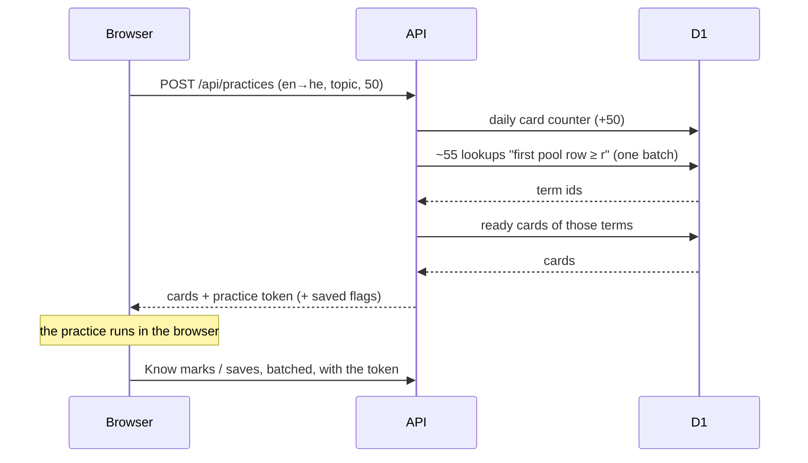
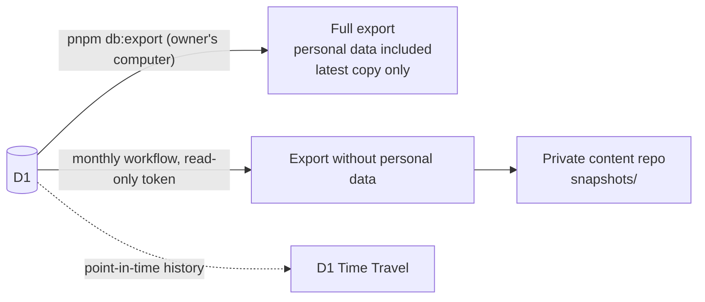

# MyVocab — Architecture concepts

The ideas behind the design, with diagrams. The exact specification (the PRD) is kept in the private content
repository; this guide explains the concepts, and the "PRD §…" references point to its sections. Diagrams are [Mermaid](https://mermaid.js.org/): GitHub and VS
Code draw them from the text. Keep this file in step with the PRD: a change to these concepts updates both.

## Contents

1. [The big picture](#1-the-big-picture)
2. [Core concepts: terms and meanings](#2-core-concepts-terms-and-meanings)
3. [Database structure](#3-database-structure)
4. [Derived data](#4-derived-data)
5. [Starting a practice and the random key](#5-starting-a-practice-and-the-random-key)
6. [Known terms, saved cards and the practice token](#6-known-terms-saved-cards-and-the-practice-token)
7. [Admin concepts](#7-admin-concepts)
8. [Staying fast](#8-staying-fast)
9. [Exports and backups](#9-exports-and-backups)
10. [Security](#10-security)
11. [Costs and limits](#11-costs-and-limits)
12. [Naming conventions](#12-naming-conventions)
13. [Glossary](#13-glossary)

---

## 1. The big picture

One Cloudflare Worker serves both the web app (static files) and the API, on the same address, with a D1 (SQLite)
database behind it. The admin area has two locks; guests pass an invisible bot check. (PRD §10.)



- **The app never reads from GitHub**; the live data is only in D1.
- **API documentation** (Swagger) is at `/api/admin/docs`, behind both admin locks, generated from the same route
  declarations that validate requests.

## 2. Core concepts: terms and meanings

A **term** is a word, an expression or an idiom in one language. A **meaning** sits in the middle and ties together the
terms of every language that mean the same thing. Each fact is stored once, and every direction (English → Hebrew,
Hebrew → English, English → Arabic…) comes from the same rows. (PRD §8.1.)



(Hebrew is transliterated in diagrams.)

What the cards show:

| Card                            | Translation                  | Explanation            | Literally                              |
| ------------------------------- | ---------------------------- | ---------------------- | -------------------------------------- |
| "Once in a blue moon" → Hebrew  | the Hebrew term on meaning B | B's Hebrew explanation | the English term's literal into Hebrew |
| the Hebrew idiom → English      | "Once in a blue moon"        | "Very rarely"          | the Hebrew term's literal into English |
| "Once in a blue moon" → English | —                            | "Very rarely"          | —                                      |

**Where each part lives:**

| Part                      | Stored on                                             | Why there                                                           |
| ------------------------- | ----------------------------------------------------- | ------------------------------------------------------------------- |
| **Translation**           | nothing: the other-language terms on the same meaning | it is a relation, not a text                                        |
| **Explanation**           | the meaning, one per language (optional)              | it describes the meaning, shared by every term on it                |
| **Literally**             | the term, per target language                         | word for word depends on the term's own words, not on the meaning   |
| **Hints, other synonyms** | the term **in** a meaning (`term_meanings`)           | "What is the date today?" is true for Date as a day, not as a fruit |
| **Exact synonyms**        | nothing: same-language terms on the same meaning      | a relation again                                                    |

**Several meanings, and asymmetry.** A term can have several meanings, and each meaning connects to different terms.
Read from the Hebrew side, each Hebrew term sees only its own meanings, so asymmetry comes out by itself:



- "Date" → Hebrew shows 1. ta'arich 2. pgisha 3. tamar (numbered; "multiple meanings" is counted).
- "tamar" → English shows only "Date"; "pgisha" → English shows "meeting" / "date".

**A plain word needs no explanation.** "fork" and its Hebrew term share a meaning with no explanation at all: the
cards are just "Translation". "extraordinary" has an English explanation, so it also gets an English → English card.

**Card: Yes / No and approval.** A term typed as a new translation exists at once (it shows on other cards' backs)
but isn't practised as a card of its own until switched on. A term created by an agent waits for the admin's approval.

## 3. Database structure

Terms and meanings get **UUIDs**: random, impossible to guess or count, and copyable from the admin for direct
database queries. Link tables are keyed by what they connect (**composite keys**). (PRD §11.1.)



**Groups of tables:**

| Group                 | Tables                                                                                             |
| --------------------- | -------------------------------------------------------------------------------------------------- |
| Content               | `languages`, `topics`, `terms`, `meanings`, `meaning_explanations`, `term_meanings`, `term_topics` |
| Derived (rebuilt, §4) | `term_cards`, `practice_pool`, `practice_counts`, `term_gaps`, `term_search_words`                 |
| Learners              | `user_known_terms`, `user_saved_cards`                                                             |
| Operations            | `usage_counters`, `app_settings`, `audit_log`                                                      |
| Sign-in (Better Auth) | `user`, `session`, `account`, `verification`                                                       |

**Keys and WITHOUT ROWID.** By default SQLite gives every row a hidden number and keeps a separate index for the real
key: two structures, the key stored twice. A **WITHOUT ROWID** table is stored directly in the order of its real key:
one structure, one step per lookup, less space. The small link and derived tables use it; `term_cards` (rows of about
1 KB) is a normal table with a unique index, because WITHOUT ROWID suits small rows. Known marks and saved cards point
at the **term** (term + direction), not at a ready card, so they survive when a card is rebuilt.

## 4. Derived data

What learners read is prepared when the admin saves, because admin writes are rare and learner reads are frequent.
(PRD §11.2.)



- **Ready card**: the whole card (front, back per meaning, literal, hints, synonyms) in one row, so a practice, "My
  known terms" or "My saved cards" reads one row per card instead of assembling it from five tables.
- **Counts change by +1 / −1**, never by recounting a topic (that would read the whole topic on every save).
- **Safety nets**: `pnpm db:rebuild-derived` rebuilds everything; a test checks that every stored card equals the card
  built on the spot.

## 5. Starting a practice and the random key

**The problem:** "give me 50 random cards" normally means reading every candidate and shuffling, so the cost grows with
the vocabulary. **The idea:** every pool row gets a random number, `rand_key`, when it's written. Sorted by that number,
the rows are already a random shuffle, made in advance. (PRD §11.3.)

**A worked example** (keys 0–99 for readability; really 0 to about 2 billion). The pool for English → Hebrew, all
topics, as the index keeps it:

| rand_key | term                   |
| -------- | ---------------------- |
| 7        | fork                   |
| 15       | extraordinary          |
| 23       | Date                   |
| 38       | swift                  |
| 41       | Once in a blue moon    |
| 56       | table                  |
| 62       | rapid                  |
| 77       | A needle in a haystack |

The server draws numbers blind (no reading needed) and asks for "the first row at or above" each one:

| Drawn | Index jumps to                                               | Picked                 |
| ----- | ------------------------------------------------------------ | ---------------------- |
| 20    | the first key ≥ 20 → 23                                      | Date                   |
| 60    | the first key ≥ 60 → 62; known by this learner, step on → 77 | A needle in a haystack |
| 97    | nothing ≥ 97 → wrap around → 7                               | fork                   |

Each lookup is an index jump (like opening a phone book at "M") that reads about one row. A 50-card practice reads about
70 pool rows and 50 ready cards, whether the vocabulary has 500 terms or 50,000. Duplicates are dropped and topped up.



- **Topics** have their own pool rows (topic 0 = all topics), and guests use the sample-set rows.
- **A "Saved cards" practice** picks from the learner's own saved cards (at most their limit), known ones included.
- **The home page** shows stored counts minus the learner's own known terms, in one request.

## 6. Known terms, saved cards and the practice token

- **Known terms** and **saved cards** are rows of user + term + direction. Known terms leave regular practices in that
  direction; saved cards can be practised on their own.
- **Sending is batched**: a Know waits a few seconds and a save about one second, so a quick change of mind costs
  nothing; pending changes are flushed when the page is left.
- **The practice token**: a practice comes with a short signed list of the cards it served. A Know or a Save is accepted
  only for a card in that list. The signature uses a secret only the server knows, so the list can't be changed. The
  proof travels in the browser, so the check writes nothing to the database.

```mermaid
sequenceDiagram
  participant B as Browser
  participant A as API
  A-->>B: cards + token {user, served cards, expiry, signature}
  B->>A: POST /me/known {token, marks}
  A->>A: recompute signature with the secret; same user; not expired; card in list
  A-->>B: saved (or ignored)
```

## 7. Admin concepts

- **One page per term**, its meanings as boxes. **One way to relate things**: type into a meaning's Translations or
  Synonyms box (autocomplete; Enter creates a term with Card: No). × takes a term off a meaning; the term stays.
- **Shared meanings say so** ("Also used by: …"): editing a meaning's explanation changes every card that shows it.
- **The duplicate guard**: adding a term that already has meanings asks "Is it one of these?", so a second "fruit"
  isn't created by mistake.
- **Quick add** (the New term page) holds the first meaning, so a typical word is one screen. **Bulk topics** work on a
  filtered selection. **Approval** covers agent-made terms and the translations created with them.
- **Ids everywhere**: every term and meaning id is shown small and grey with a copy button.

## 8. Staying fast

- **Cursor paging**: "the 50 after the last one seen" instead of "page 7" (which reads and throws away the rows before
  it).
- **Stored facts for filters**: gaps such as "no Hebrew translation" are rows written on save, so a filter is an index
  lookup.
- **Search words**: one row per word of a term's text, so typing "blu" jumps to "Once in a blue moon" (about 10–20 rows
  per keystroke instead of every term).
- **The index guard**: a test asks SQLite for the plan of every frequent query and fails if one would read a whole
  table.

## 9. Exports and backups



Each export holds JSON per table (loads into any database), SQL, a ready **SQLite file**, the vocabulary CSV
(re-importable) and a README with loading steps, including PostgreSQL. (PRD §8.6.)

## 10. Security

Kept in the private content repository to avoid abuse.

## 11. Costs and limits

Kept in the private content repository to avoid abuse.

## 12. Naming conventions

- **term**, never "word" (a term can be a word, an expression or an idiom); learner pages say "terms" too.
- **Translation, Explanation, Literally, Synonyms**: the same names on the card, in the admin and in the code.
- **card front / card back** (`front` / `back` inside a card object); never "answer" for the card back.
- **`lang_source` / `lang_target`** for a direction (`langSource` / `langTarget` in the API and code); a single language
  is `lang`.
- **No legacy names**: a renamed concept is renamed everywhere. The only exceptions are applied migration files, old
  audit details and one-off converters.

## 13. Glossary

| Term                    | Meaning                                                                                |
| ----------------------- | -------------------------------------------------------------------------------------- |
| Term                    | A word, an expression or an idiom in one language                                      |
| Meaning                 | What terms mean, shared across languages; it ties the terms of every language          |
| Explanation             | A meaning described in one language (optional)                                         |
| Translation             | The terms in the target language on the same meaning                                   |
| Literally               | A term's word-for-word translation into another language                               |
| Card                    | One term in one direction; on screen a flip card (card front, card back)               |
| Ready card              | The finished card, stored per term and direction                                       |
| Practice pool           | The playable cards with their random keys                                              |
| Random key (`rand_key`) | A random number per pool row that makes random picking a cheap index jump              |
| Practice token          | A signed list of the cards a practice served; Know and Save are accepted only for them |
| Card: Yes / No          | Whether a term is practised as a card of its own                                       |
| Awaiting approval       | An agent-made term not yet approved                                                    |
| Composite key           | A key made of two or more columns together (e.g. term + meaning)                       |
| WITHOUT ROWID           | A SQLite table stored directly in the order of its key, without a hidden row number    |
